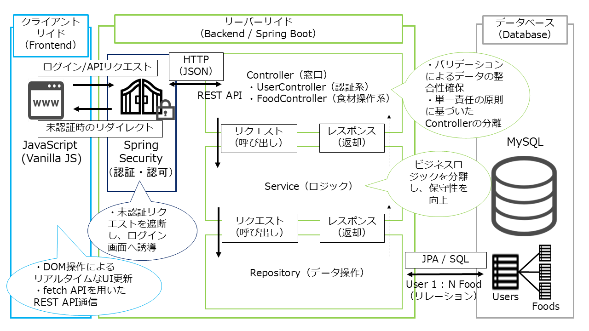

# Smart Refrigerator Manager

Smart Refrigerator Manager helps households track food inventory, prioritise items nearing their use-by dates, and reduce food waste. Release 2 adds account-based data ownership, an English/Japanese interface, waste tracking, and inventory-aware meal suggestions.

## Project overview

The application addresses common kitchen problems: forgetting what is in the refrigerator, losing track of expiry dates, and throwing away food that could have been used. Each account has a private inventory with expiry alerts, search and filtering, waste records, and meal suggestions based on available ingredients.

## Technology stack

| Area | Technology |
| --- | --- |
| Backend | Java 21, Spring Boot 3.4.1, Spring MVC, Spring Security |
| Frontend | Vanilla JavaScript, HTML5, CSS3, Thymeleaf |
| Local database | H2 in-memory database |
| Optional database | MySQL 8 |
| Production database | PostgreSQL |
| Persistence | Spring Data JPA / Hibernate |
| Build | Maven |
| Password storage | BCrypt |

## Architecture

The application uses a layered architecture to keep responsibilities clear and reduce coupling.

<p align="center">
  
</p>

- **Spring Security** handles authentication, access control, and session logout.
- **Controllers** expose the web pages and REST endpoints for user, inventory, waste, and menu features.
- **Services** contain application and business rules, including account ownership checks and inventory-aware suggestions.
- **Repositories** use Spring Data JPA to persist users, foods, and waste events.
- **Entities** model the domain and its relationships, including the one-to-many relationship between a user and their food records.

The browser client communicates with the backend through JSON APIs. User-owned records are queried and changed in the context of the authenticated account.

## Features

### Accounts and security

- Sign up with a username, email address, and password.
- Sign in and sign out using Spring Security form authentication.
- Store passwords as BCrypt hashes.
- Keep each account's food and waste records private to that account.
- Edit the display name and preferred interface language in the profile.
- Request a password reset using a single-use email code that expires after 10 minutes.

### Food inventory

- Add, update, search, filter, and remove food records.
- Track quantity, category, expiry date, and restock status.
- Highlight items based on how soon they expire.
- Show inventory totals and items that need attention.

### English and Japanese interface

The interface supports English and Japanese. The chosen language is applied across the login and dashboard experience and can be saved as the account's preferred language. Inventory names and other user-entered values remain as entered.

### Waste history

Recording food as waste updates the active inventory and adds a corresponding account-owned waste-history event in a single transaction.

### Meal suggestions

Suggestions use the current account's available inventory. A local ingredient matcher works without an external AI service. An optional OpenAI-compatible chat-completions provider can generate suggestions in the user's preferred language. When enabled, inventory names, categories, quantities, and expiry dates are sent to the configured provider. Configure an appropriate privacy notice and review provider data handling before enabling it.

## Run locally

### Requirements

- Java 21
- Internet access on the first run so Maven can download dependencies

### Start the application

The default `local` profile uses an in-memory H2 database. Its data is reset when the application stops.

```bash
./mvnw spring-boot:run
```

If the Maven wrapper does not have execute permission, run:

```bash
sh mvnw spring-boot:run
```

Open [http://localhost:8080](http://localhost:8080) in a browser.

The local profile creates a demo account and 20 sample foods when the database is empty:

| Username | Password |
| --- | --- |
| `demo` | `Demo12345!` |

Use this account only for local development.

### Optional MySQL profile

Set the database environment variables and activate the `mysql` profile:

```bash
export DB_URL='jdbc:mysql://localhost:3306/refrigerator_db?serverTimezone=UTC&useSSL=false&allowPublicKeyRetrieval=true'
export DB_USERNAME='your-username'
export DB_PASSWORD='your-password'
sh mvnw spring-boot:run -Dspring-boot.run.arguments=--spring.profiles.active=mysql
```

### Production database

The `prod` profile uses PostgreSQL and expects these environment variables:

```text
DB_HOST
DB_NAME
DB_USER
DB_PASSWORD
```

Do not commit production credentials or secrets to the repository. Supply them through the hosting platform's secret manager or environment configuration.

## Email and AI configuration

### Password reset email

Configure Spring Mail using the standard `spring.mail.*` properties (for example, `SPRING_MAIL_HOST`, `SPRING_MAIL_PORT`, `SPRING_MAIL_USERNAME`, and `SPRING_MAIL_PASSWORD`). If SMTP is not configured, the reset code is written to the application log for local development. This fallback is not suitable for production.

### Optional AI meal suggestions

Set the following environment variables to enable an OpenAI-compatible chat-completions service:

```text
AI_API_KEY
AI_API_URL   # Optional; defaults to https://api.openai.com/v1/chat/completions
AI_MODEL     # Optional; defaults to gpt-4o-mini
```

If no API key is configured, the application uses its local ingredient matcher.

## Configuration summary

| Profile | Database | Intended use |
| --- | --- | --- |
| `local` (default) | H2 in-memory | Development and demonstration; data resets when the app stops |
| `mysql` | MySQL | Optional persistent local database |
| `prod` | PostgreSQL | Hosted deployment with externally supplied environment variables |

## Project documentation

- [Agile project pack](./output/pdf/Smart-Refrigerator-Agile-Project-Pack.pdf) — project scope, requirements, and assessment planning.
- [ScrumDesk implementation playbook](./output/pdf/ScrumDesk-Implementation-Playbook.pdf) — detailed ScrumDesk setup, epics, stories, acceptance criteria, sprint planning, workflow, and team responsibilities.
- [Development activity record](./output/pdf/Smart-Refrigerator-Development-Activity-Record.pdf) — activity record and outstanding evidence.

## Current release and next steps

Release 2 covers the bilingual web interface, account/profile flows, waste history, and inventory-aware meal suggestions. The planned Flutter QR-scanning application is outside this release and can be developed in a later update. Further work may include automated unit and integration test coverage and additional accessibility review.

## Development approach

AI tools were used as a pair-programming aid for design discussion, implementation support, and debugging. The project owner reviewed and adapted generated suggestions to understand the architecture, security choices, and code included in the application.
